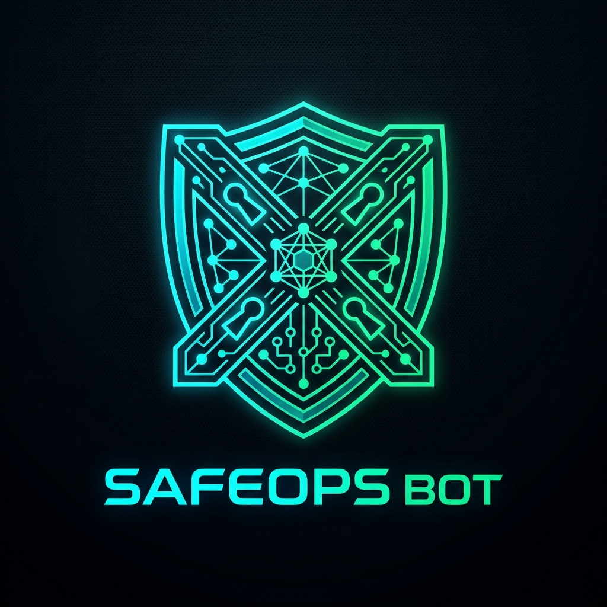

# SafeOps BOT — Contract Admin and Permission Inspector

<p align="center">
  
</p>

<p align="center">
  <b>Contract Admin, Access Control, and Permission Inspector for Botchain & EVM</b><br />
  <a href="WHITEPAPER.md">📖 Read the Technical Whitepaper</a> • 
  <a href="https://scan.botchain.ai/address/0x098D204F9F93f855a15Ea72D5d85b7df1FFd2974">🌐 BotchainScan Contract</a>
</p>

---

SafeOps BOT investigates **who controls a smart contract and what those administrators are allowed to do**. While general security tools check broad vulnerability patterns, SafeOps conducts deep forensic analysis into administrative power, role privileges, proxy upgradeability, and governance structures.

---

## ⚡ Key Capabilities

1. **Current Owner Detection**:
   - Queries standard and custom ownership interfaces (`owner()`, `getOwner()`, `admin()`).
   - Identifies whether the owner is a single **EOA** (private key) or a smart contract.
2. **Role-Based Access Control (RBAC)**:
   - Identifies OpenZeppelin `AccessControl` implementations (`hasRole`, `getRoleAdmin`).
   - Tests standard administrative roles (`DEFAULT_ADMIN_ROLE`, `PAUSER_ROLE`, `MINTER_ROLE`, `UPGRADER_ROLE`).
3. **Proxy & Upgradeability Forensics**:
   - Inspects standard ERC-1967 storage slots:
     - Implementation Slot: `0x360894a13ba1a3210667c828492db98dca3e2076cc3735a920a3ca505d382bbc`
     - Admin Slot: `0xb5352742e0d006000522c0a4417429076779a72985382624083cd20337765710`
     - Beacon Slot: `0xa3f0ad74e5423aebfd80d3ef4346578335a9a72aeaee59ff6cb3582b35133d50`
   - Recognizes Transparent Proxies, UUPS proxies (`proxiableUUID`), and Diamond EIP-2535.
4. **Multisig & Timelock Recognition**:
   - Inspects whether controllers are **Gnosis / Safe** multisigs (recovering signer count and threshold e.g. 3-of-5).
   - Inspects Timelock controllers and delay windows (`getMinDelay()`).
5. **Critical Discrepancy Flagging**:
   - Alerts users when a protocol advertises decentralized governance while a single private key (EOA) retains instant upgrade or pause authority.
6. **Confidence Classification**:
   - **Confirmed Findings**: Direct on-chain return value or standard proxy storage slot verification.
   - **Likely Findings**: Bytecode heuristic opcode and function selector matches.
   - **Unverified Controls**: Notes unverified or opaque custom permissions with explicit limitations disclosure.

---

## 🌐 On-Chain Registry Deployment

- **Network**: Botchain Mainnet
- **Chain ID**: `677`
- **Native Token**: `BOT`
- **RPC Endpoint**: `https://rpc.botchain.ai`
- **Block Explorer**: `https://scan.botchain.ai`
- **Deployed SafeOpsRegistry Contract**:
  ```
  0x098D204F9F93f855a15Ea72D5d85b7df1FFd2974
  ```
  *(Verified on BotchainScan: `https://scan.botchain.ai/address/0x098D204F9F93f855a15Ea72D5d85b7df1FFd2974`)*

---

## 🏗️ Project Architecture

```
safeOps BOt/
├── contracts/
│   ├── contracts/
│   │   └── SafeOpsRegistry.sol       # Gas-only check record & anchor registry
│   ├── scripts/
│   │   └── deploy.js                 # Automated Botchain deployment script
│   ├── test/
│   │   └── SafeOpsRegistry.test.js   # 100% passing test suite
│   ├── hardhat.config.js             # Hardhat network config (Botchain & local)
│   └── package.json
├── frontend/
│   ├── src/
│   │   ├── app/
│   │   │   ├── api/
│   │   │   │   ├── inspect/route.ts       # Permission inspection engine endpoint
│   │   │   │   └── anchor-report/route.ts # On-chain anchor endpoint
│   │   │   ├── layout.tsx
│   │   │   ├── page.tsx                   # Command Center UI & visual topology
│   │   │   └── globals.css                # Pure Vanilla CSS design system
│   │   ├── config/
│   │   │   └── botchain.ts                # Viem chain definition
│   │   ├── context/
│   │   │   └── Web3Provider.tsx           # Reown AppKit + Wagmi provider
│   │   ├── contracts/
│   │   │   └── SafeOpsRegistry.json       # Compiled contract ABI
│   │   └── lib/
│   │       └── inspector.ts               # Core permission & admin analysis engine
│   └── package.json
└── .env.local
```

---

## 🚀 Running the Project

### Smart Contracts (Compile & Test)
```bash
cd contracts
npx hardhat test
npx hardhat run scripts/deploy.js --network botchain
```

### Frontend App
```bash
cd frontend
npm run dev
```
Open [http://localhost:3005](http://localhost:3005) in your browser.
